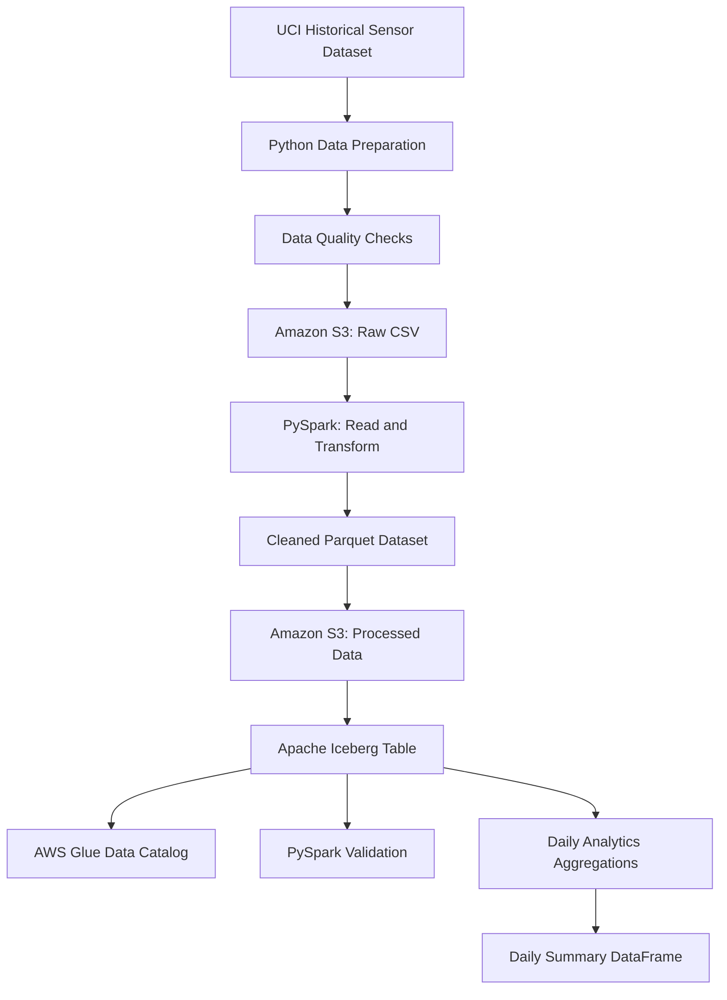

# IoT Sensor Data Platform with PySpark, Amazon S3, Apache Iceberg and AWS Glue

## Project Overview

This project demonstrates an end-to-end batch data engineering workflow for processing historical sensor readings using Python, PySpark, Amazon S3, Apache Iceberg and the AWS Glue Data Catalog.

The pipeline ingests a real-world sensor dataset, performs data quality checks, stores processed data in Parquet format, creates an Iceberg table, validates data integrity, and generates daily sensor analytics.

The project was built to explore data lake concepts, distributed data processing, table management, cloud object storage and analytical transformations.

**Project type:** Historical-data batch processing  
**Dataset:** UCI Single Elder Home Monitoring dataset  
**Processing engine:** Apache Spark / PySpark  
**Table format:** Apache Iceberg  
**Cloud storage:** Amazon S3  
**Catalog:** AWS Glue Data Catalog

## Architecture



*The diagram describes the implemented batch workflow. It does not represent a live device-to-cloud streaming pipeline.*

## Technology Stack

- **Python:** Data preparation, validation and orchestration.
- **PySpark:** Data processing, aggregation and table queries.
- **Amazon S3:** Cloud object storage for raw, processed and Iceberg data.
- **Apache Parquet:** Columnar storage for processed sensor readings.
- **Apache Iceberg:** Table format supporting snapshots, metadata management and safe table operations.
- **AWS Glue Data Catalog:** Metadata catalog used to register and discover the Iceberg tables.
- **Google Colab:** Environment used to run Spark processing without provisioning AWS compute instances.

## Dataset

The project uses the UCI Single Elder Home Monitoring dataset, containing historical environmental sensor readings.

The processed dataset contains **416,153 records** with the following fields:

- `source_record_id`
- `event_time`
- `temperature`
- `humidity`
- `CO2CosIRValue`
- `CO2MG811Value`
- `MOX1`, `MOX2`, `MOX3`, `MOX4`
- `COValue`
- `source_dataset`
- `source_dataset_id`

The recorded time range is November 6, 2019, through February 13, 2020.

The source dataset does not provide device identifiers for these records, so the project does not invent device IDs.

## Pipeline Workflow

### 1. Data ingestion

The original sensor dataset was prepared as a CSV file and uploaded to Amazon S3.

### 2. Data cleaning and quality checks

Python was used to prepare the cleaned dataset and a data quality report. The cleaned data was saved in Parquet format.

### 3. Cloud storage

The S3 project layout used the following logical prefixes:

```text
iot-platform-v2/
├── raw/
│   └── sensor_readings_source.csv
├── processed/
│   ├── sensor_readings_clean.parquet
│   └── data_quality_report.json
├── quarantine/
└── warehouse/
    └── iceberg/
```

The quarantine prefix was created as part of the pipeline layout. The final dataset contained no records requiring quarantine.

### 4. Apache Iceberg table creation

The cleaned data was loaded into an Iceberg table registered in the AWS Glue Data Catalog:

`glue_catalog.iot_platform_db.sensor_readings`

The table uses Parquet data files and Iceberg metadata to manage table state and snapshots.

### 5. Data validation

The pipeline checked total records, unique record IDs, null values, numeric sensor values, timestamp ranges and record-count reconciliation.

### 6. Daily analytics

PySpark grouped readings by calendar date and calculated reading counts, temperature statistics, average humidity and average sensor readings.

The resulting 99-row daily summary was generated as a Spark DataFrame in memory; it was not persisted as a separate analytics table.

### 7. Incremental ingestion demonstration

A separate test Iceberg table was used to demonstrate appending records and retry-safe insertion with `MERGE INTO`. Replaying the same record IDs did not introduce duplicates in that test.

The incremental test table was separate from the main sensor readings table.

## Results

| Validation or output | Result |
|---|---:|
| Total sensor records | 416,153 |
| Unique source record IDs | 416,153 |
| Duplicate ID excess | 0 |
| Null IDs | 0 |
| Null timestamps | 0 |
| Null temperatures | 0 |
| Null humidity values | 0 |
| Raw CSV record count | 416,153 |
| Cleaned Parquet record count | 416,153 |
| Iceberg table record count | 416,153 |
| Daily analytics rows | 99 |

Additional validation found no duplicate full rows, invalid timestamps or non-finite numeric sensor values in the checked dataset.

The timestamp-gap analysis identified 31 intervals longer than 60 seconds, with a maximum gap of approximately 46.2 hours. These gaps were documented rather than filled with invented readings.

## Example Analytical Use Cases

The daily summary supports questions such as:

- How did average temperature change over time?
- Which days had the highest average humidity?
- How many sensor readings were recorded per day?
- Which dates had higher average values for a particular sensor field?
- Were some dates represented by fewer readings than others?

Sensor fields are treated as recorded measurements. The project does not claim that uncalibrated sensor values establish a confirmed health or safety incident.

## Cost and Execution Approach

Spark processing was run in Google Colab rather than on paid AWS compute instances. Amazon S3 and the AWS Glue Data Catalog were used for cloud storage and metadata management during development.

The AWS account was closed after development to avoid maintaining an active cloud environment. Therefore, the original cloud resources are not currently available for a live demonstration.

Cloud service usage may incur charges depending on the account, region, service and applicable credits.

## Limitations and Future Improvements

- The project processes historical data in batches; it does not implement live MQTT ingestion.
- AWS IoT Core, device certificates and live device publishing were not configured.
- The daily analytics DataFrame was not persisted as a separate table.
- Timestamp gaps were identified but not automatically repaired.
- A future version could add MQTT ingestion, AWS IoT Core, scheduled batch execution, persisted analytics outputs and a dashboard.

## Reproducibility

The notebook contains the implementation and validation workflow. To reproduce the complete cloud workflow, a user needs an AWS account, suitable S3 and Glue permissions, the required Spark/Iceberg dependencies, and the dataset.

The historical-data transformations and analytics can be adapted to run locally or in Google Colab without provisioning AWS compute, provided the dataset and required dependencies are available.

**Security:** Never commit AWS access keys, secret keys, credentials or other sensitive information to a public repository.